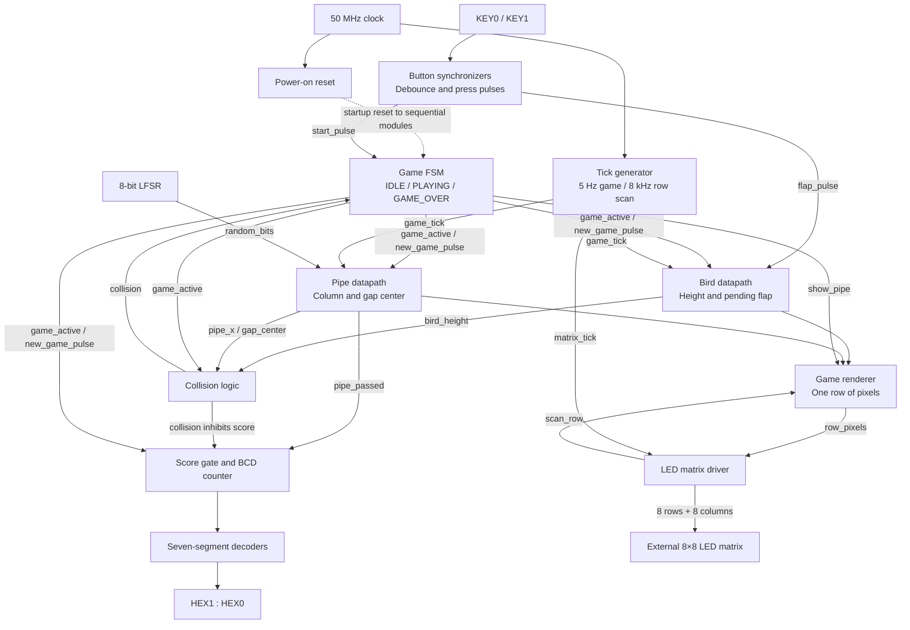

# Discrete Flappy Bird on FPGA

A hardware implementation of Flappy Bird written in **SystemVerilog**, developed with **Quartus** for a **DE10 FPGA board**, and played on an external **8×8 LED matrix**. The matrix displays the bird and approaching pipes; the board's seven-segment displays show the score.

The supplied source identifies the board as a **DE10-Lite**. This documentation follows that target. Other DE10 variants require their own device selection, clock configuration, and pin assignments.

The game runs entirely in FPGA logic: counters set the update rates, a finite-state machine controls play, registers track the bird and pipe, and a row-scanning circuit drives the display. There is no processor, software game loop, or frame buffer in this design.

## Gameplay

- The bird is one LED at the left edge of the matrix.
- A one-column-wide pipe moves from right to left with a three-pixel opening.
- Each flap moves the bird up two positions on the next game update. Without a flap, it falls one position.
- Passing a pipe adds one point. Hitting a pipe ends the game.
- The score runs from `00` to `99` and stops at `99`.
- The top and bottom edges clamp the bird's position; touching them alone does not end the game.

| Control or display | Function |
| --- | --- |
| `KEY0` / `key0` | Start from idle or restart after game over; ignored during play |
| `KEY1` / `key1` | Flap; release and press again for another flap |
| External 8×8 matrix | Bird and pipe display |
| `HEX0` / `hex0` | Score ones digit |
| `HEX1` / `hex1` | Score tens digit |
| `HEX2`–`HEX5` | Blank |

Holding the flap button does not repeatedly flap. Multiple accepted presses before the next game update combine into one pending flap.

## System block diagram

All sequential modules use the same 50 MHz `clk`. The two tick signals are clock enables, not separate clocks. Clock and reset connections are abbreviated above for readability.

## Hardware and tools

- DE10-Lite FPGA development board and USB programming cable.
- External 8×8 LED matrix. The supplied top level assumes **row cathodes active LOW** and **column anodes active HIGH**, described in the original project notes as a 788A/788AS matrix.
- Jumper wiring and current limiting appropriate to the actual matrix and drive circuit.
- A Quartus installation with support for the board's FPGA and the USB-Blaster driver.

The original notes record 220 Ω resistors in the row paths. The complete electrical schematic and chosen FPGA GPIO pins are not included. See the [hardware guide](docs/HARDWARE_AND_QUARTUS.md) before reproducing the wiring.

## Build and run

1. Create a Quartus project and select the device fitted to your board. For the DE10-Lite, the board manual specifies `10M50DAF484C7G`. See the [Terasic DE10-Lite User Manual, hosted by Mouser](https://www.mouser.com/datasheet/2/598/DE10-Lite_User_Manual-1100361.pdf).
2. Add all **13 `.sv` files** in this folder as SystemVerilog sources.
3. Set **`top_level`** as the top-level entity.
4. Run Analysis & Elaboration to expose the ports in Pin Planner.
5. Assign the clock, buttons, six seven-segment buses, and matrix buses using your board and wiring. The exact port names are lowercase, such as `hex0[0]` and `matrix_rows[0]`.
6. Add a timing constraint for the 50 MHz input clock and run a full compilation. See the [Quartus setup steps](docs/HARDWARE_AND_QUARTUS.md#quartus-project-setup).
7. Open Programmer, select the USB-Blaster hardware, and program the compiled `.sof` through JTAG.
8. Press `KEY0` to begin. Tap `KEY1` to steer through the openings. After a collision, press `KEY0` to start a new game.

**Repository status:** the HDL is included, but a Quartus project (`.qpf`), pin assignments (`.qsf`), timing constraints (`.sdc`), testbench, and programming image are not supplied. This is a source project that requires board setup before compilation and programming.

## Documentation

| Document | Contents |
| --- | --- |
| [Design documentation](docs/DESIGN.md) | Module descriptions, state diagram, movement rules, collision and scoring, timing, and display pipeline |
| [Hardware and Quartus guide](docs/HARDWARE_AND_QUARTUS.md) | Matrix wiring table, signal polarity, top-level ports, build steps, bring-up, and troubleshooting |

The block diagrams use Mermaid and render on GitHub and in Markdown viewers with Mermaid support. A plain-text display example is also included in the design documentation.

## Source files

| File | Responsibility |
| --- | --- |
| [`top_level.sv`](top_level.sv) | Connects all modules and selects the project parameters |
| [`power_on_reset.sv`](power_on_reset.sv) | Generates the startup reset |
| [`button_conditioner.sv`](button_conditioner.sv) | Synchronizes and debounces a button; generates one press pulse |
| [`tick_generator.sv`](tick_generator.sv) | Generates game and row-scan enables |
| [`game_fsm.sv`](game_fsm.sv) | Controls idle, playing, and game-over states |
| [`bird_datapath.sv`](bird_datapath.sv) | Stores bird height and applies flap/gravity updates |
| [`lfsr8.sv`](lfsr8.sv) | Generates pseudorandom bits for pipe openings |
| [`pipe_datapath.sv`](pipe_datapath.sv) | Moves the pipe, chooses its opening, and signals passage |
| [`collision_logic.sv`](collision_logic.sv) | Detects overlap between the bird and pipe pixels |
| [`score_counter.sv`](score_counter.sv) | Maintains a two-digit decimal score |
| [`sevenseg.sv`](sevenseg.sv) | Converts a decimal digit to active-low segment outputs |
| [`game_renderer.sv`](game_renderer.sv) | Computes the eight pixels for the selected matrix row |
| [`led_matrix_driver.sv`](led_matrix_driver.sv) | Selects rows and applies row/column output polarity |

## Current scope

This version has one bird, one pipe at a time, fixed game speed, four possible gap centers, and a volatile score. Game over freezes the last scene; there is no separate game-over animation. The documentation describes the supplied RTL. No new hardware test or Quartus timing/resource result is claimed.
