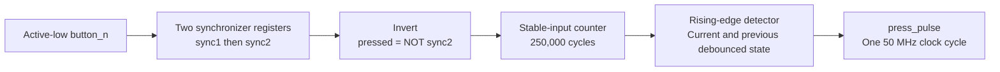
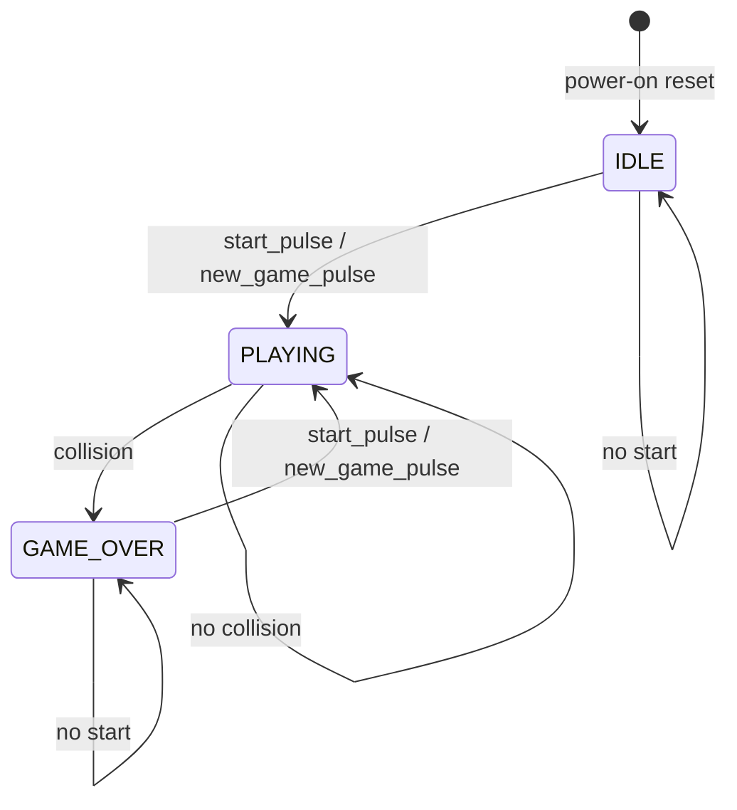
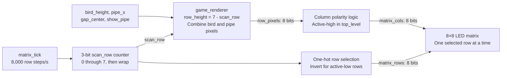

# Discrete Flappy Bird: design documentation

[README](../README.md) · [Hardware and Quartus guide](HARDWARE_AND_QUARTUS.md)

## 1. Design overview

This project implements a small Flappy Bird game as synchronous digital logic on a DE10-Lite FPGA. Its external 8×8 LED matrix is both the playfield and the game display. The player controls the vertical position of a single illuminated pixel while a pipe moves horizontally toward it.

The design separates **control**, **stored game state**, and **display generation**. The controller decides whether play is active. The bird and pipe datapaths update their registers on a slow game tick. Combinational logic checks collisions and draws the selected display row. A fast row scanner makes the complete image visible.

There is no CPU, instruction memory, operating system, external RAM, VGA output, or stored 64-pixel frame buffer in the supplied implementation. Quartus synthesizes the SystemVerilog modules into FPGA registers and combinational logic.

See the [system block diagram](../README.md#system-block-diagram) for the complete signal path.

## 2. Coordinates and the 8×8 playfield

The game uses three-bit coordinates, covering values `0` through `7`.

| Quantity | Meaning |
| --- | --- |
| `bird_height` | Vertical bird coordinate: `0` is bottom, `7` is top |
| `BIRD_X` | Fixed bird column: `7` in `top_level.sv` |
| `pipe_x` | Pipe column: starts at `0`, advances toward `7` |
| `gap_center` | Middle height of the pipe's three-pixel opening |
| `scan_row` | Display row index: `0` is top, `7` is bottom |
| `row_height` | Game height corresponding to the scanned row: `7 - scan_row` |

In the assumed physical orientation, `matrix_cols[7]` is leftmost and `matrix_cols[0]` is rightmost. Increasing `pipe_x` therefore moves a pipe left on the display.

Example scene with `bird_height = 4`, `pipe_x = 2`, and `gap_center = 4`:

```text
                    Physical left -> right
Logical column:      7 6 5 4 3 2 1 0
                     ---------------
scan_row 0  height 7  . . . . . # . .
scan_row 1  height 6  . . . . . # . .
scan_row 2  height 5  . . . . . . . .  <- opening
scan_row 3  height 4  B . . . . . . .  <- opening center
scan_row 4  height 3  . . . . . . . .  <- opening
scan_row 5  height 2  . . . . . # . .
scan_row 6  height 1  . . . . . # . .
scan_row 7  height 0  . . . . . # . .

B = bird LED, # = pipe LED, . = unlit pixel
Pipe motion: column 0 -> 1 -> 2 -> ... -> 7
```

The letters above explain the image; the real monochrome matrix represents both bird and pipe with lit LEDs.

## 3. Clock, reset, and timing

Every `always_ff` block uses the rising edge of `clk`. The top level assumes a **50 MHz** clock, equivalent to a **20 ns** period. The game and matrix ticks are single-clock pulses used as enables inside this one clock domain.

| Item | Configuration in this project | Result |
| --- | --- | --- |
| Game divider | `50_000_000 / 5` | 10,000,000 input cycles per tick |
| Game update | `GAME_HZ = 5` | One movement update every 200 ms |
| Row divider | `50_000_000 / 8_000` | 6,250 input cycles per tick |
| Matrix row selection | `MATRIX_ROW_HZ = 8_000` | One row slot every 125 µs |
| Complete eight-row scan | `8_000 / 8` | 1,000 scans per second; 1 ms per scan |
| Nominal LED scan duty cycle | One selected row out of eight | 1/8 for a pixel that remains lit |
| Button debounce | `250_000` input cycles | Approximately 5 ms of stable input, plus synchronization/pipeline latency |
| Startup reset counter | Counts from 15 to 0 | Reset spans 15 rising edges, nominally about 300 ns |

`tick_generator.sv` has a standalone `GAME_HZ` default of `12`, but **`top_level.sv` overrides it to `5`**. The top-level override determines the actual game speed.

`game_tick` and `matrix_tick` are registered. Receiving registers observe an asserted tick on the following rising edge because of nonblocking assignment semantics. This adds one input-clock cycle of latency without changing the steady-state rates.

The tick counters reset only on power-on reset. Restarting a game does not restart their phase, so the delay from starting to the first movement update can be shorter than 200 ms.

### Startup versus a new game

`power_on_reset.sv` initializes a four-bit counter to `4'hF`, decrements it to zero, and asserts `reset` while it is nonzero. The source relies on Quartus support for FPGA register power-up initialization. It is not an external reset-button circuit.

Power-on reset initializes the FSM, button logic, timing counters, bird, pipe, random generator, score, and scan-row counter. The matrix driver blanks its outputs while reset is asserted.

`new_game_pulse` is a separate event generated by the FSM. It resets the bird, pipe, and score for a new round. It does not reseed the LFSR, reset the tick generators, or restart the display scanner. Since the FSM registers this pulse, the receiving datapaths apply their new-game initialization on the next clock edge.

## 4. Button input path

Two instances of `button_conditioner.sv` handle `key0` and `key1` independently.



The synchronization registers reduce the chance that an asynchronous input transition propagates metastability into game logic. The debounce counter accepts a change only after the synchronized input remains different from the current accepted state for the configured interval. Both pressing and releasing must be accepted before another distinct press can be detected.

The resulting `start_pulse` goes to the FSM. The `flap_pulse` goes to the bird datapath, where a pending bit preserves it until a game tick. This is necessary because a 20 ns pulse could otherwise be missed by a game that moves only every 200 ms.

## 5. Game controller

[`game_fsm.sv`](../game_fsm.sv) stores one of three states:



Power-on reset returns the controller to `IDLE` from any state. The diagram abbreviates those reset transitions.

| State | `game_active` | `game_over` | `show_pipe` | Visible behavior |
| --- | --- | --- | --- | --- |
| `IDLE` | 0 | 0 | 0 | Bird at initial height; pipe hidden; score `00` |
| `PLAYING` | 1 | 0 | 1 | Movement enabled and pipe visible |
| `GAME_OVER` | 0 | 1 | 1 | Last bird/pipe scene and score remain visible |

`KEY0` is checked in `IDLE` and `GAME_OVER` only. It does not interrupt an active round. `KEY1` does not start the game, and flap requests outside `PLAYING` are discarded. The display continues scanning in every state.

The `game_over` output is connected to an internal signal in `top_level.sv`, but it has no downstream display or indicator consumer. The frozen scene comes from disabling the datapaths while leaving `show_pipe` asserted.

## 6. Bird datapath

[`bird_datapath.sv`](../bird_datapath.sv) holds `bird_height[2:0]` and a one-bit `flap_pending` flag. Reset or a new game sets the height to `4` and clears the pending flag.

While the game is active, a `flap_pulse` sets `flap_pending`. At the next game tick, the position update is:

```text
if flap_pending OR flap_pulse:
    next_height = min(current_height + 2, 7)
else:
    next_height = max(current_height - 1, 0)
```

After the tick, `flap_pending` clears. A press arriving on the same cycle as the tick is included through the explicit `flap_pulse` condition. Multiple presses between ticks do not accumulate multiple upward moves.

Examples: a flap at height `4` moves to `6`; a flap at `6` saturates at `7`; a tick without a flap at `4` moves to `3`. At `0`, further gravity updates leave the bird at `0`.

This is a discrete position model. There is no velocity register, acceleration integration, or continuous trajectory. Only the occupied pixel after each update is tested for collision.

## 7. Pipe datapath and pseudorandom openings

[`pipe_datapath.sv`](../pipe_datapath.sv) stores a three-bit `pipe_x` and three-bit `gap_center`. There is only one pipe column at a time.

- Power-on reset sets `pipe_x = 0` and `gap_center = 4`.
- A new game sets `pipe_x = 0` and chooses a gap from the random input.
- Each active game tick increments `pipe_x` until it reaches `BIRD_X = 7`.
- On the next active tick with the pipe already at `7`, the module emits `pipe_passed`, returns the pipe to `0`, and chooses another gap.

The pipe remains at the bird's column for one game interval before recycling, provided no collision ends play. After the initial tick phase, a complete eight-update pipe cycle takes **1.6 seconds** at 5 Hz.

The gap contains the three heights `gap_center - 1`, `gap_center`, and `gap_center + 1`, including both endpoints.

| `random_bits` | `gap_center` | Open heights |
| --- | --- | --- |
| `00` | 2 | 1, 2, 3 |
| `01` | 3 | 2, 3, 4 |
| `10` | 4 | 3, 4, 5 |
| `11` | 5 | 4, 5, 6 |

[`lfsr8.sv`](../lfsr8.sv) generates the random input with an eight-bit linear-feedback shift register initialized to `8'hA5`:

```systemverilog
lfsr <= {lfsr[6:0], lfsr[7] ^ lfsr[5] ^ lfsr[4] ^ lfsr[3]};
assign random_bits = lfsr[1:0];
```

The LFSR advances on every 50 MHz clock after reset, including while idle or game over. The pipe samples its two low bits only when choosing a new opening. This is a deterministic pseudorandom sequence whose sampled values depend on timing, not a physical randomness source. Adjacent pipes can have the same opening.

## 8. Collision and scoring

[`collision_logic.sv`](../collision_logic.sv) is combinational. It asserts:

```text
collision = game_active
            AND (pipe_x == BIRD_X)
            AND ((bird_height < gap_center - 1)
                 OR (bird_height > gap_center + 1))
```

A bird at either edge of the opening is safe. No collision occurs with a pipe in a different column. Screen-edge contact alone is safe. When the registered positions produce a collision, the FSM samples it on the next 50 MHz rising edge and enters `GAME_OVER`; it does not wait for another game tick.

The bird and pipe update together on an active tick. Collision logic then sees their updated coordinates. There is no swept-path check for intermediate rows skipped during a two-position flap.

Scoring uses the following gate in `top_level.sv`:

```systemverilog
score_pulse = pipe_passed && game_active && ~collision;
score_reset = reset || new_game_pulse;
```

`pipe_passed` lasts one input-clock cycle and is emitted when the pipe wraps from column `7` to column `0`. It is not emitted merely on arrival at the bird's column. The counter consumes the registered pulse on the following clock edge. If a collision has ended play, the `game_active` gate prevents a score increment.

[`score_counter.sv`](../score_counter.sv) stores two four-bit decimal digits. It increments the ones digit, carries from `09` to `10`, and saturates at `99`. Reset and each new game clear both digits.

Two [`sevenseg.sv`](../sevenseg.sv) instances decode the digits into active-low outputs. `hex0` shows ones and `hex1` shows tens, including a leading zero. The segment encoding is consistent with `{g, f, e, d, c, b, a}`; for example, zero is `7'b1000000`. The unused `hex2` through `hex5` buses are assigned `7'h7F`, turning their segments off.

## 9. Renderer and multiplexed matrix output



For each scanned row, [`game_renderer.sv`](../game_renderer.sv) starts with eight unlit pixels. It lights the bird's column if the row height equals `bird_height`. It also lights the pipe's column if `show_pipe` is true and the row height lies outside the gap. These contributions are combined: a pipe pixel cannot erase a bird pixel.

[`led_matrix_driver.sv`](../led_matrix_driver.sv) advances `scan_row` on each matrix tick. Its three-bit counter wraps naturally after row `7`. It forms `row_onehot = 8'b00000001 << scan_row` and applies configurable polarity.

| Signal | Top-level setting | Active behavior |
| --- | --- | --- |
| Rows | `ROW_ACTIVE_HIGH = 0` | Selected row is LOW; other rows HIGH |
| Columns | `COL_ACTIVE_HIGH = 1` | Lit pixel's column is HIGH |
| During reset | Blanked by driver | All rows HIGH; all columns LOW |

For example, selecting `scan_row = 2` with only column `7` lit produces `matrix_rows = 8'b11111011` and `matrix_cols = 8'b10000000`.

The driver module's standalone polarity defaults are the opposite of this project's settings. The explicit overrides in `top_level.sv` are therefore essential to reproducing the intended display behavior.

Pixels are recomputed from live game state for each row. There is no frame buffer, frame-boundary synchronization, or explicit blanking interval between row changes. A game update may occur partway through a scan. These are properties of the current implementation, not additional features.

## 10. Module interface reference

Clock/reset inputs are omitted below where their role is already described. Widths are shown for multi-bit signals.

| Module | Main inputs | Main outputs |
| --- | --- | --- |
| `power_on_reset` | `clk` | `reset` |
| `button_conditioner` | `button_n` | `press_pulse` |
| `tick_generator` | Parameters: clock, game, and row rates | `game_tick`, `matrix_tick` |
| `game_fsm` | `start_pulse`, `collision` | `game_active`, `game_over`, `show_pipe`, `new_game_pulse` |
| `bird_datapath` | `game_active`, `game_tick`, `flap_pulse`, `new_game_pulse` | `bird_height[2:0]` |
| `lfsr8` | Clock and reset | `random_bits[1:0]` |
| `pipe_datapath` | `game_active`, `game_tick`, `new_game_pulse`, `random_bits[1:0]` | `pipe_x[2:0]`, `gap_center[2:0]`, `pipe_passed` |
| `collision_logic` | `game_active`, `bird_height[2:0]`, `pipe_x[2:0]`, `gap_center[2:0]` | `collision` |
| `score_counter` | `score_pulse` | `score_ones[3:0]`, `score_tens[3:0]` |
| `sevenseg` | `bin_in[3:0]` | `seg_out[6:0]` |
| `game_renderer` | `scan_row[2:0]`, `bird_height[2:0]`, `pipe_x[2:0]`, `gap_center[2:0]`, `show_pipe` | `row_pixels[7:0]` |
| `led_matrix_driver` | `matrix_tick`, `row_pixels[7:0]` | `scan_row[2:0]`, `matrix_rows[7:0]`, `matrix_cols[7:0]` |
| `top_level` | `clk`, `key0`, `key1` | Six seven-segment buses and two matrix buses |

## 11. Configuration and extension points

| Change | Where to change it | Related considerations |
| --- | --- | --- |
| Game speed | `GAME_HZ` override in `top_level.sv` | Changes bird and pipe speed together |
| Row-scan rate | `MATRIX_ROW_HZ` override in `top_level.sv` | Full-display rate is row rate divided by eight |
| Input clock | `CLK_HZ`, timing constraint, and board clock assignment | Debounce time also depends on the actual clock |
| Debounce interval | `DEBOUNCE_CYCLES` in `button_conditioner.sv`, or instance overrides | Applies to both press and release acceptance |
| Flap/gravity step | `bird_datapath.sv` | Preserve saturation at heights 0 and 7 |
| Gap size | `pipe_datapath.sv`, `collision_logic.sv`, and `game_renderer.sv` | Generated gaps, collision boundaries, and drawn pixels must agree |
| Matrix polarity | Driver instance parameters in `top_level.sv` | Must match actual matrix wiring and any external inversion |
| Horizontal orientation | Output-bit mapping or coordinated changes to bird/pipe coordinates | Changing only `BIRD_X` to 0 makes the present pipe logic recycle immediately |

Divider parameters must be positive and yield valid divisors. Integer division truncates if the requested frequency does not divide the clock exactly. The supplied rates divide 50 MHz exactly.

Possible future additions include multiple pipe columns, increasing difficulty, a high-score register, a game-over animation, and explicit blanking between row changes. These are not implemented in the supplied source.

## 12. Verification scope

This documentation was derived from the supplied RTL and original project notes. The repository contains no simulation testbench, saved waveform, Quartus compilation report, timing report, resource-use report, or recorded hardware test results. The timing values above are calculated from parameters rather than measurements.

Useful checks for a future simulation or hardware validation are:

| Check | Expected result |
| --- | --- |
| Power-up | FSM idle, bird at height 4, score 00, pipe hidden after reset |
| Start/restart | New round at column 0 with an allowed gap and score 00 |
| Debounce and hold | Short unstable transitions rejected; holding a button produces one press |
| Flap between ticks | Next active tick moves the bird up two, subject to top saturation |
| No flap | Each active tick lowers the bird by one, subject to bottom saturation |
| Gap boundaries | Heights `center - 1` and `center + 1` are safe at the bird column |
| Collision | Outside-gap overlap enters game over and stops further movement |
| Pipe passage | A surviving pipe wraps once and increases score once |
| Decimal score | 09 becomes 10; 99 remains 99 |
| Display scan | Exactly one row selected outside reset; all rows visited in order |
| New-game timing | Tick phase continues; initial movement delay may be less than 200 ms |

For simulation, small divider and debounce parameter overrides can shorten runtime. They should be kept separate from the settings used to program the board.
