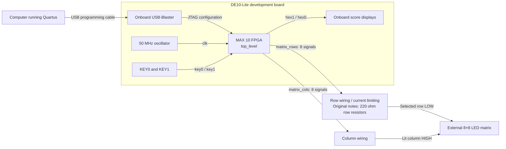

# Hardware, wiring, and Quartus setup

[README](../README.md) · [Design documentation](DESIGN.md)

## Board target and available information

The user-built project uses a DE10 FPGA board, Quartus, and an external 8×8 LED matrix. The HDL comments and original project notes specifically identify **DE10-Lite**. The guide below follows that target; DE10-Nano and other DE10 boards have different hardware and pin assignments.

The DE10-Lite uses a MAX 10 `10M50DAF484C7G`. Its 50 MHz `MAX10_CLK1_50` clock is on `PIN_P11`. The board's programming connection uses an onboard USB-Blaster. These board details are documented in the [Terasic DE10-Lite User Manual, hosted by Mouser](https://www.mouser.com/datasheet/2/598/DE10-Lite_User_Manual-1100361.pdf), particularly the board overview and sections 3.1–3.2.

The original notes also identify a 788A/788AS-style matrix and 220 Ω resistors in its row paths. No circuit schematic, board photo, chosen GPIO assignments, or matrix manufacturer datasheet is supplied. The matrix package pin table below preserves those project notes; it is not an independently verified pinout for every matrix with a similar part number.

## Hardware connection block diagram



This is a functional connection diagram, not a complete electrical schematic. It shows the row-resistor arrangement recorded in the original notes; GPIO header contacts and FPGA package locations must be filled in from the actual build.

## Top-level ports

Use these exact names in Quartus. HDL names are lowercase even though the board labels are uppercase.

| Port | Direction | Width | Connection |
| --- | --- | --- | --- |
| `clk` | Input | 1 | 50 MHz board clock |
| `key0` | Input | 1 | Active-low start/restart push button |
| `key1` | Input | 1 | Active-low flap push button |
| `hex0` | Output | 7 | Active-low ones digit segments |
| `hex1` | Output | 7 | Active-low tens digit segments |
| `hex2`, `hex3`, `hex4`, `hex5` | Output | 7 each | Unused onboard displays, held off |
| `matrix_rows` | Output | 8 | External matrix row selection |
| `matrix_cols` | Output | 8 | External matrix column pixel data |

The top level has **61 individual I/O signals**: 3 inputs, 42 seven-segment outputs, and 16 matrix outputs. There is no `leds` or `LEDR` output bus in this version.

## Matrix polarity and orientation

The top-level driver parameters select:

```systemverilog
.ROW_ACTIVE_HIGH (1'b0),
.COL_ACTIVE_HIGH (1'b1)
```

For this row-cathode, column-anode connection, one row is selected by driving it LOW. A column driven HIGH lights its LED in that selected row. The other seven rows remain HIGH. During reset, every row is HIGH and every column is LOW.

The intended viewing orientation is:

- `matrix_rows[0]`: top physical row.
- `matrix_rows[7]`: bottom physical row.
- `matrix_cols[7]`: leftmost physical column, occupied by the bird.
- `matrix_cols[0]`: rightmost physical column, where pipes spawn.

Check the exact component's pinout and orientation before connecting it. Similar-looking matrix packages may use different internal connections or pin numbering.

### Matrix package pin mapping from the original notes

The numbers in this table are **LED matrix package pins**, not FPGA package pins or DE10-Lite GPIO header positions.

| HDL row signal | Matrix row label | Matrix package pin | HDL column signal | Matrix column label | Matrix package pin |
| --- | --- | --- | --- | --- | --- |
| `matrix_rows[0]` | Row 1 | 9 | `matrix_cols[0]` | Column 1 | 13 |
| `matrix_rows[1]` | Row 2 | 14 | `matrix_cols[1]` | Column 2 | 3 |
| `matrix_rows[2]` | Row 3 | 8 | `matrix_cols[2]` | Column 3 | 4 |
| `matrix_rows[3]` | Row 4 | 12 | `matrix_cols[3]` | Column 4 | 10 |
| `matrix_rows[4]` | Row 5 | 1 | `matrix_cols[4]` | Column 5 | 6 |
| `matrix_rows[5]` | Row 6 | 7 | `matrix_cols[5]` | Column 6 | 11 |
| `matrix_rows[6]` | Row 7 | 2 | `matrix_cols[6]` | Column 7 | 15 |
| `matrix_rows[7]` | Row 8 | 5 | `matrix_cols[7]` | Column 8 | 16 |

For every connection, record the complete chain:

```text
HDL port bit -> FPGA package location in Quartus
             -> board GPIO header contact
             -> current-limiting / drive circuit
             -> LED matrix package pin
```

The first two hardware mapping steps cannot be reconstructed from the HDL alone. Use the board's GPIO table and your wiring to complete them. Do not assign matrix package pin numbers directly as FPGA locations.

### Current limiting

Retain current limiting when reproducing the matrix circuit. The original notes describe 220 Ω row resistors, but this value and arrangement alone do not establish the current in each LED or compliance with FPGA drive limits. A shared row resistor carries the combined current of lit LEDs in that row, so brightness can depend on the pattern. Determine the resistor and any external driver requirements from the actual LED specifications, supply voltage, and FPGA I/O limits before reproducing the electrical design.

The source scans one row at a time. It contains no external driver IC protocol or programmed constant-current control. Any external transistor or driver stage must be accounted for in the wiring and output polarity.

## Quartus project setup

The exact Quartus version used for the original build was not recorded. Use a release/edition that supports the device on your board and install its device support and USB-Blaster driver. The following is a project setup guide; menu wording may vary by release.

1. **Create the project.** Use the New Project Wizard and choose a project directory and name. Set the top-level entity to `top_level`.
2. **Select the device.** For the DE10-Lite target, select `10M50DAF484C7G`, checking the actual board first. Do not reuse this device choice for another DE10 variant.
3. **Add all 13 source files.** Add every `.sv` file listed in the [README](../README.md#source-files). Keep SystemVerilog enabled; constructs such as `logic`, `always_ff`, and `always_comb` require it.
4. **Elaborate the design.** Run Analysis & Elaboration. Resolve missing-module or language errors before assigning pins.
5. **Assign locations and I/O standards.** In Pin Planner, assign every top-level port to the appropriate board connection. Consult the board manual for clock, button, seven-segment, and GPIO locations. If using a board-generated template, adapt its signal names to this project's lowercase ports and remove assignments for unused ports.
6. **Add clock constraints.** Create an SDC file, add it to the project, and constrain `clk` as shown below. Review asynchronous button input paths and external output requirements for the actual build; the clock constraint alone is not a complete interface timing specification.
7. **Compile.** Run a full compilation. Review errors, pin assignments, I/O standards, warnings, and Timing Analyzer results. Resolve unconstrained paths appropriately rather than assuming a successful compile proves timing closure.
8. **Program through JTAG.** Connect the board, open Programmer, choose the USB-Blaster in Hardware Setup, and use JTAG mode. Add the generated `.sof`, enable Program/Configure, and start programming. See section 3.1 of the [Terasic board manual](https://www.mouser.com/datasheet/2/598/DE10-Lite_User_Manual-1100361.pdf) for the board-specific programming procedure.
9. **Check the initial display.** After startup reset, the bird should be visible at height 4, the pipe hidden, and the score `00`. Press `KEY0` to start.

Example base-clock constraint to place in your project's SDC file:

```tcl
create_clock -name clk -period 20.000 [get_ports {clk}]
```

Both tick signals remain enables in the 50 MHz domain. Do not describe them as separate clocks in the timing constraints.

A `.sof` JTAG load is a temporary configuration. Persistent startup configuration requires the board's flash-programming procedure; it is separate from this quick-start workflow. See chapter 6 of the [Terasic board manual](https://www.mouser.com/datasheet/2/598/DE10-Lite_User_Manual-1100361.pdf).

### Files needed to reproduce the original build

The current repository includes RTL and documentation. To preserve a reproducible hardware build, also retain:

- The Quartus `.qpf` and `.qsf`, including exact device, source list, pin locations, and I/O standards.
- The `.sdc` timing constraints.
- A wiring schematic or clearly labeled connection table identifying GPIO header contacts, resistor placement, and the exact matrix part.
- The Quartus version and compilation/timing reports associated with a tested build.

No guessed GPIO assignments are provided in this documentation.

## Hardware bring-up

| Step | Expected observation |
| --- | --- |
| Program and allow reset to finish | One bird pixel at the left edge; score `00`; other HEX displays blank |
| Press `KEY0` | Pipe appears on the right and starts moving left |
| Leave `KEY1` released | Bird moves down one position per game tick and stops at the bottom |
| Tap `KEY1` | On the next game tick, bird rises two positions, clamped at the top |
| Hold `KEY1` | Only the initial accepted press requests a flap |
| Move through the opening | Pipe reaches the bird column, then wraps right; score increases once |
| Overlap a solid pipe pixel | Bird and pipe freeze; score stays visible |
| Press `KEY0` after game over | Bird resets to height 4, score clears, and a new pipe begins at column 0 |

These are expected results from the RTL, not a claim that these checks were run on the physical board during documentation work.

## Troubleshooting

| Symptom | Check |
| --- | --- |
| Most LEDs appear lit or the image looks inverted | Verify matrix row/column polarity and that the top-level driver overrides are present |
| Display is mirrored or upside down | Check physical orientation and the logical row/column wiring order |
| Bird appears on the wrong side | Confirm column 7 is leftmost; changing only `BIRD_X` does not reverse the pipe logic |
| LEDs are scrambled or entire lines are missing | Check package-pin versus GPIO-header numbering and each bus-bit assignment |
| Matrix is dark | Check pin assignments, row/column connections, drive circuit, clock input, and programming status |
| Buttons do nothing | Confirm active-low button assignments; `KEY0` starts only from idle/game over |
| Holding flap does not keep moving upward | Expected: the input conditioner generates one event per accepted press |
| Movement seems delayed after a press | Expected: a flap is applied at the next 5 Hz game tick |
| Pipes move at an unexpected speed | Check the actual clock frequency and `GAME_HZ` override in `top_level.sv` |
| Seven-segment digits are incorrect | Check bit-to-segment assignments and active-low polarity |
| Quartus reports old `leds[*]` nodes | Remove stale assignments from an older project's `.qsf`; this top level has no such port |
| Matrix shows ghosting between rows | Inspect row/column transition behavior; the present driver has no inter-row blanking interval |

## References and provenance

- Game behavior, parameter values, and module interfaces: the [SystemVerilog source files](../README.md#source-files).
- Matrix package-pin mapping and the reported 220 Ω row resistors: the original project `README.txt`, consolidated into this guide. The exact matrix datasheet and physical assembly remain unverified.
- Board device, clock location, peripherals, and programming procedure: [Terasic DE10-Lite User Manual, June 5, 2020, hosted by Mouser](https://www.mouser.com/datasheet/2/598/DE10-Lite_User_Manual-1100361.pdf). Consult the manual matching the actual board revision for a new build.
